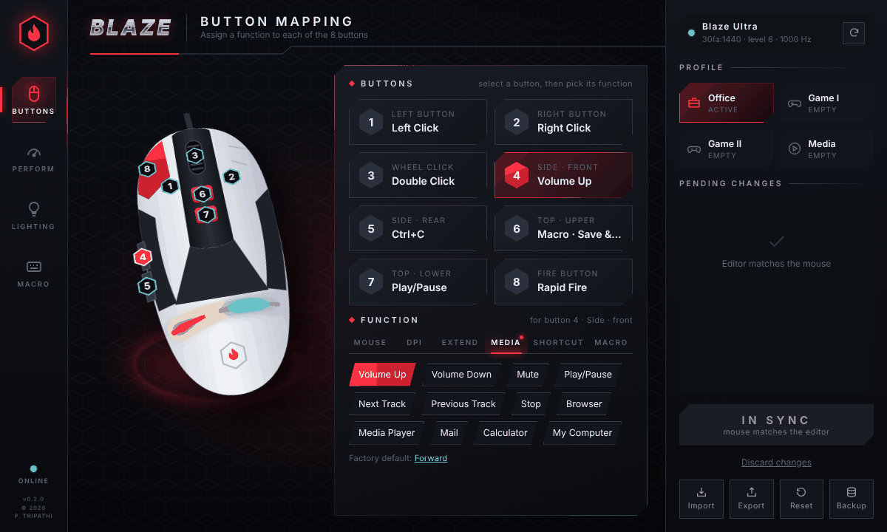
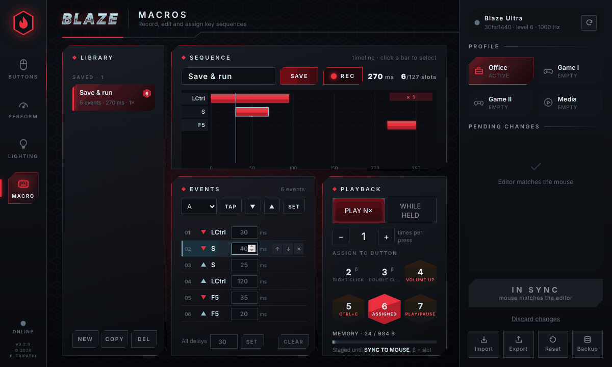
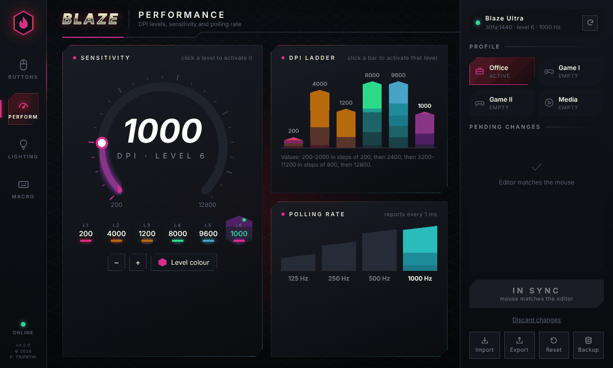
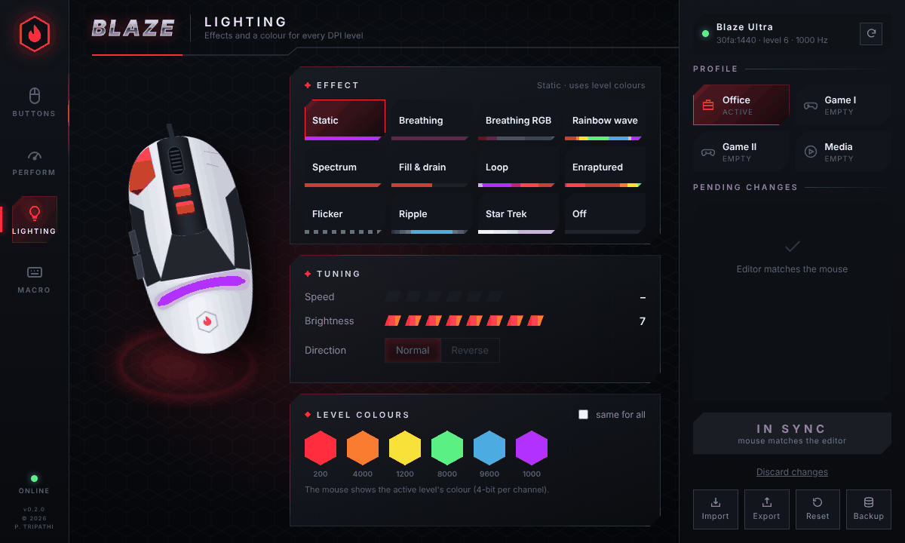

# blazectl

[](https://github.com/pranjaltripathi684-wq/blazectl/actions/workflows/tests.yml)


[](LICENSE)

An open-source configurator for the **EvoFox Blaze Ultra** gaming mouse that runs on **Windows and Linux**.
The official EvoFox software is Windows-only, crashes, fails to detect the mouse, and doesn't say whether a
setting was saved. The mouse's USB protocol is undocumented, so I reverse-engineered it. blazectl now does
nearly everything the official app does (all but profile switching and music-reactive lighting), and it verifies
every write.



## Download

**Windows app: BLAZE Control.** Get it from the [Releases page](https://github.com/pranjaltripathi684-wq/blazectl/releases/latest):

| File | What it is |
|---|---|
| `BLAZE-Control-Setup-<version>.exe` | Installer: Start Menu + desktop shortcut, uninstall from Windows Settings. No admin rights needed. |
| `BLAZE-Control-Portable-<version>.zip` | Portable: unzip anywhere and run `BLAZE Control.exe`. Nothing is installed. |

No Python needed. The app opens in its own window (it uses the Edge WebView2 runtime built into Windows 10/11).

> **"Windows protected your PC"?** Windows shows this for new apps that aren't code-signed (signing
> certificates are paid). Click **More info → Run anyway**. The app is built from this repository's source by
> GitHub Actions ([build-app workflow](.github/workflows/build-app.yml)), so you can check exactly what's in it.

**Prefer the manual setup** (Python, command line, Linux)? See [Windows](#windows) and
[Linux](#linux-kali-etc) below. `python -m blazectl gui` opens the same interface in a browser app window,
and `python -m blazectl app` opens it in its own window after `pip install pywebview`.

| Feature | Command | GUI page |
|---|---|---|
| RGB lighting: 12 effects, colour per DPI level, speed, brightness, direction | `light` | Lighting |
| DPI: 6 levels, all 23 values from 200 to 12800 | `dpi` | Performance |
| Polling rate: 125 / 250 / 500 / 1000 Hz | `poll` | Performance |
| Button remapping: 8 buttons, 12 functions | `buttons` | Buttons |
| Media keys (volume, play/pause, tracks, mute, browser, mail…) and shortcuts (e.g. Ctrl+C) | `buttons` | Buttons |
| Keyboard macros: record/edit, play N times or while held, buttons 2-7 | `macro` | Macro |
| Full memory backup | `dump --save` | Backup |

Every change is **verified by reading it back**, undone automatically if it doesn't stick, and reported
in plain words. That fixes the original software's silent failures, crashes and "did it save?" problems.

| Macro editor | Performance | Lighting |
|---|---|---|
|  |  |  |

## Highlights

- **Protocol reverse-engineered from scratch for this mouse.** Change one setting in the official app, dump the
  mouse's 4 KB config memory, diff, repeat. Each decoded value has its evidence in [FINDINGS.md](FINDINGS.md).
- **Byte-for-byte fidelity.** The test suite replays the official app's own changes (macros, media keys,
  shortcuts) on a simulated mouse and checks the result against memory dumps from the real mouse.
- **Safe by design.** It writes only to decoded memory areas, checks the header before writing, reads back
  every block, and refuses to remove the last Left Click.
- **Hardened local web GUI.** Uses only Python's standard library, listens on 127.0.0.1 only, requires a
  per-session token, checks the Host header against DNS rebinding, and sends a strict CSP (details below).
- **No dependencies on Linux.** It talks to `/dev/hidraw` directly. On Windows it needs only `hidapi`.

## Windows

1. Install Python 3.10+ (python.org or `uv`). Open a terminal in this folder.
2. Create an environment and install:
   ```
   uv venv            (or: py -m venv .venv)
   .venv\Scripts\activate
   uv pip install -e . hidapi      (or: python -m pip install -e . hidapi)
   ```
3. **Close the EvoFox app completely** (Task Manager → End task, and disable it in Startup apps).
   While it runs, it can overwrite your settings.
4. Run:
   ```
   python -m blazectl gui
   ```
   This opens the BLAZE command center as its own window (an Edge or Chrome app window):
   - **Left rail:** Buttons, Performance, Lighting, Macro.
   - **Workspace:** a tilted mouse view with button cards and a function picker; a DPI gauge, a level
     ladder and a polling meter; lighting effect tiles, tuning pips and per-level colours; a macro editor
     with a key timeline, keyboard recording (REC), a named library, play-N-times / while-held modes, and
     assignment to buttons 2-7.
   - **Right column:** profiles (Office / Game I / Game II / Media, saved on your PC), a live list of
     pending changes, **Sync to mouse** (or Ctrl+S), and Import / Export / Reset / Backup.

   Close the terminal window to quit.

## Linux (Kali etc.)

1. **One-time permission rule.** This is the only step that needs root:
   ```
   sh scripts/linux-setup.sh
   ```
   It installs one udev rule (`udev/99-evofox-blaze.rules`) so your normal user can access the mouse.
   Replug the mouse afterwards.
2. Python setup, no root needed. blazectl itself needs no extra packages on Linux:
   ```
   python3 -m venv .venv && . .venv/bin/activate && pip install -e .
   python3 -m blazectl list          # the mouse should show "rw"
   ```
3. GUI: `python3 -m blazectl gui`. It opens in Chromium/Chrome as an app window if installed,
   otherwise in your default browser (e.g. Firefox). No extra packages are needed.

## Command line

```
python -m blazectl light static --color "#ff0000"
python -m blazectl light static --color "#ffff00" "#0000ff" "#ff00ff" "#00ff00" "#ff0000" "#00ffff"
python -m blazectl light rainbow --speed 2
python -m blazectl light off

python -m blazectl dpi                                                   # show
python -m blazectl dpi --set 600 1000 2400 1800 7200 12800 --execute     # write (dry run without --execute)
python -m blazectl dpi --active 3 --execute                              # switch to level 3

python -m blazectl poll
python -m blazectl poll --rate 1000 --execute

python -m blazectl buttons                                  # show mapping
python -m blazectl buttons 7=dpi-up 6=dpi-down --execute    # remap
python -m blazectl buttons --reset --execute                # factory mapping
python -m blazectl buttons 4=media:volume-up 7=media:play-pause --execute
python -m blazectl buttons 5=shortcut:ctrl+c --execute

python -m blazectl macro                                    # show macros on the mouse
python -m blazectl macro set 4 "lctrl down 10, c tap 20, lctrl up 10" --execute
python -m blazectl macro set 7 "x tap 40" --hold --execute  # repeats while held
python -m blazectl macro set 5 "h tap 30, i tap 30" --repeat 3 --execute
python -m blazectl macro clear 4 --execute                  # back to the factory function

python -m blazectl dump --save backup.json                  # read-only memory backup
```

- DPI values: 200, 400 … 2000 (steps of 200), 2400, 3200 … 11200 (steps of 800), 12800.
- Button functions: `left-click middle-click right-click back forward dpi-loop dpi-up dpi-down
  double-click show-desktop rapid-fire led-loop`.
- Buttons: 1 left, 2 right, 3 wheel, 4 front side, 5 rear side, 6 upper top, 7 lower top, 8 red fire button.
  Button 8 only supports `rapid-fire` and `dpi-loop`. Other functions do nothing on it, even when set by
  the official app (a firmware limit).
- Media keys: `volume-up volume-down mute play-pause next-track prev-track stop browser media-player mail
  calculator my-computer` (volume-up and play-pause confirmed against the official app; the rest use the
  standard USB codes). Shortcuts: any of `ctrl shift alt win` plus one key, e.g. `shortcut:ctrl+shift+esc`.
  Both work on buttons 2-7.
- Macros: `KEY down|up|tap [ms after]`, comma separated. Keys: `a`-`z`, `0`-`9`, `enter`, `space`, `tab`,
  `esc`, `backspace`, `f1`-`f12`, `lctrl lshift lalt lwin`, `up down left right`, `kp0`-`kp9` and more.
  Buttons 2-7 can hold a macro (4-7 confirmed against the official app; 2 and 3 follow the same pattern).
  Up to 127 slots per macro (each slot = one event, long delays use one extra slot per 127 ms).
- DPI, polling, button and macro changes make the mouse reload, which resets lighting. The GUI re-applies your
  lighting automatically; on the command line, run `light` again.

## The GUI and its security

`blazectl gui` serves a single-page app from Python's standard library. Because that page can control a
USB device, the server is locked down:

- It listens on **127.0.0.1 only**, on a random port, so nothing on your network can reach it.
- Every API call needs a **random per-session token** that only the opened window knows. Other websites
  open in your browser can't drive the mouse (CSRF protection).
- The **Host header** must be `127.0.0.1`/`localhost`, which blocks DNS-rebinding attacks.
- The page has a strict Content-Security-Policy and loads nothing from the internet. Request bodies are
  size-limited.

These are covered by `tests/test_webui.py`. A simpler tkinter window is still available with
`blazectl gui --classic`.

## Safety

- Writes only touch decoded areas (settings blocks, and the macro area laid out exactly like the official
  app does it); anything else is refused.
- The mouse's memory header is checked before any write. Writes are refused if the current contents
  look unexpected.
- At least one button must stay Left Click.
- Only values and functions observed on the real mouse are allowed. Nothing is guessed or rounded.
- `dump` / `Backup…` saves the full settings memory before you experiment.

## How it was decoded

See [FINDINGS.md](FINDINGS.md) for the full protocol, memory map and the evidence for each value. In short:

- The mouse is an **Instant Microelectronics** chip (USB `30fa:1440`). Its settings channel is 8-byte
  feature report `0x07` on vendor usage page `0xFF01`.
- Lighting packets and the config-memory read/write protocol come from the same chip family, as
  documented by OpenRGB and open-isy4500-customizer.
- DPI table, polling byte and button layout were decoded **specifically for this mouse**: change one
  setting in the official app, dump the memory with blazectl, compare. For example, polling turned out to
  be a single byte = (1000 / Hz) − 1, found by diffing 1 KB dumps at 1000 Hz and 125 Hz and confirmed
  with a polling-rate tester.
- Unit tests pin the encoders to bytes the official app actually wrote.

The generic reverse-engineering toolkit is included too: `probe` (HID report descriptors), `analyze` /
`diff` / `checksum` (Wireshark USB captures from USBPcap or usbmon), `extract` / `replay`.

## Development

```
pip install -e ".[dev]"     (add "hidapi" on Windows)
python -m pytest            # GUI tests run when tkinter and a display are available
```

Build the Windows app yourself (normally GitHub Actions does this when a release is published):

```
pip install . pywebview hidapi pyinstaller
python packaging/make_version_info.py
pyinstaller --noconfirm --clean packaging/blaze_control.spec     # -> dist/BLAZE Control/BLAZE Control.exe
set BLAZE_VERSION=0.2.0 && iscc packaging/installer.iss          # -> dist/BLAZE-Control-Setup-0.2.0.exe (needs Inno Setup)
```

```
blazectl/drivers/instant.py   protocol: lighting, memory, DPI table, polling, buttons
blazectl/drivers/macro.py     macro storage format (events, per-button entries, layout)
blazectl/service.py           high-level operations (used by both GUIs)
blazectl/webui.py, web/       local web GUI (server + single-page app)
blazectl/gui.py               classic tkinter GUI
blazectl/cli.py               command line
blazectl/app.py               BLAZE Control desktop app (native window around the web GUI)
packaging/                    app icon, PyInstaller spec, Inno Setup installer script
blazectl/backend.py           picks hidraw (Linux) or hidapi (Windows)
blazectl/hidraw.py, winhid.py transports
blazectl/capture.py, analysis.py, replay.py, descriptor.py   reverse-engineering toolkit
udev/, scripts/linux-setup.sh Linux permissions
tests/                        simulated mouse, real-dump test vectors
docs/screenshots/             README images (rendered from the simulated mouse)
.github/workflows/tests.yml   CI: the test suite on Linux and Windows
.github/workflows/build-app.yml  builds the Windows installer + portable ZIP for each release
```

## License

Copyright © 2026 Pranjal Tripathi.

blazectl is free software: you can redistribute it and/or modify it under the terms of the
**GNU General Public License v3.0 or later** (see [LICENSE](LICENSE)). You may use, study, share and change
it, but any copy or modified version you distribute must keep this copyright notice, credit the original
author, and be released with its source code under the same license.

The protocol findings in [FINDINGS.md](FINDINGS.md) were produced for this project by the author. If you use
them elsewhere, please credit "blazectl by Pranjal Tripathi" with a link to this repository.

## Disclaimer

blazectl is an independent project and isn't affiliated with EvoFox or Amkette. It writes to your mouse's
settings memory: take a backup first (`dump --save` or **Backup** in the GUI). Use it at your own risk.

## Credits

Lighting constants: OpenRGB's InstantMouseController (Morgan Guimard). Packet layouts and the
config-memory protocol: [open-isy4500-customizer](https://github.com/julianfdz/open-isy4500-customizer)
(MIT, compatible with GPL-3.0). `tests/isy_vectors.json` was generated by running that project's code.
