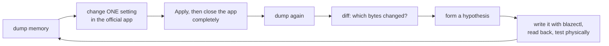

# Reverse-engineering a budget gaming mouse

*How the EvoFox Blaze Ultra's undocumented USB protocol was decoded for blazectl*
*Pranjal Tripathi · November 2026*

The EvoFox Blaze Ultra is a budget gaming mouse sold in India. Its configuration software is
Windows-only, crashes when applying settings, sometimes doesn't see the mouse, and never says whether
a change actually saved. I wanted my own tool that works on Windows and on Kali Linux. There was no
documentation, so the protocol had to be worked out from the outside.

This is how it was done in two days, mostly by **changing one setting at a time and comparing memory
dumps**. Full byte-level evidence is in [FINDINGS.md](../FINDINGS.md).

## 1. What is it, really?

```
> blazectl list
hid6   30fa:1440  if=1   VENDOR CONFIG IF   INSTANT USB Gaming Mouse
```

Vendor ID **0x30FA** belongs to **Instant Microelectronics**, a chip maker whose mouse controllers are
sold under many brands. That mattered: others had already studied sibling mice.

`blazectl probe` (it parses HID report descriptors) showed the mouse's interface 1 split into collections:

| collection | what it is |
|---|---|
| usage page **0xFF01**, feature report **0x07**, 8 bytes | the **settings channel** |
| usage page 0xFF00, input report 0x06 | an event channel |
| Consumer / System Control / Keyboard | how the mouse sends media keys and macro keystrokes |

On Windows each collection is a separate device, and Windows locks the normal mouse and keyboard
ones. The vendor collection can be opened by any user. That's why configuration tools don't need
admin, and it's the basis of the [security note](security/macro-persistence.md).

## 2. Standing on shoulders

Two open projects already talked to Instant chips:

* **OpenRGB**'s `InstantMouseController`: the lighting packets.
* **open-isy4500-customizer** (MIT, by julianfdz): lighting **and** a memory protocol, verified on a sibling
  mouse (30fa:1040).

The memory protocol is small:

```
read   07 18 05 i  aL aH 00 n-1    then GET_FEATURE -> byte 1 is memory[a+i]
write  07 18 03 i  aL aH v  n-1    one packet per byte
commit 07 18 09 00 aL aH 00 n-1    store the written bytes
reload 07 18 10 ...                apply stored settings (resets RAM lighting)
```

**Never trust a sibling's memory map**, though. blazectl's first rule: read before writing. The first
`blazectl dump` returned a header of `5a 03 a5 40 14 fa 30 10`. That's the family's magic number
followed by this mouse's PID and VID, little-endian. The layout matched, so writes were allowed, but
only to blocks we had decoded ourselves.

## 3. The method: diff the memory, one change at a time



`blazectl dump --save x.json` and `blazectl memdiff a.json b.json` did most of the work. Example: the
polling rate. Dump at 1000 Hz, set 125 Hz in the app, dump again:

```
0x018:   19  3f  32  00  9a  ff [01]  00
      →  19  3f  32  00  9a  ff [07]  00

1 byte(s) changed in 1 block(s)
```

One byte in 1 KB. `07` for 125 Hz suggested **report interval in ms − 1**: 1000 Hz → 00, 500 → 01,
250 → 03, 125 → 07. A puzzle: a dump taken after choosing 1000 Hz in the app still showed `01`. Rather
than guess, blazectl wrote each value itself, and an online **polling-rate tester** measured 1000, 250,
500 and 123 Hz. So the encoding was right and the app's own "1000 Hz" Apply simply hadn't taken.
Lesson: **verify with an independent instrument, not just the vendor's UI.**

## 4. DPI: a table with a gap

Six DPI levels are packed into 4 bytes of block 0x10: a 5-bit code per level, low nibbles two per
byte, and the fifth bit of all six codes in another byte. The sibling mouse used DPI = code × 200,
which matched low values but not high ones (code 24 = 12800, not 4800).

Dumps gave anchor points (codes 1, 2, 3, 4, 5, 8, 9, 12, 17, 18, 24). The rest came from a simple
trick: **step the official app's DPI slider with the arrow keys and write down every stop**:

```
200 … 2000 (step 200) · no 2200 · 2400 · 3200 … 11200 (step 800) · 12800
```

That's 10 + 1 + 12 = **23 values, exactly the number of valid codes**, and every anchor fit. The
prediction was then tested: set 3200 4000 4800 8000 9600 11200 in the app, dump, and the codes came
out `[13, 14, 15, 19, 21, 23]` as predicted.

**Mistake worth admitting:** an early build rounded unknown DPI values to the nearest code × 200.
A stale copy of it wrote `[3,5,12,9,24,24]` instead of the requested values. It was harmless (rewritten
seconds later), but since then blazectl **refuses any value it can't encode exactly**, and every write
is read back and automatically undone if the mouse didn't store it.

## 5. Buttons: menu order, not names

Each of the 8 buttons is one byte: 3 flag bits (kept as they are) and a 5-bit function code. The codes
follow the official app's **menu order** (Left Click = 1, Middle = 2, Right = 3, Back = 4, Forward = 5,
DPI Loop = 6, then the Extend menu) rather than any standard. Every code was confirmed by having the
app write it and testing the button physically. Middle Click was confirmed when a remapped button closed
a browser tab.

Two surprises:

* **Button 8 (the red "fire" button) lives in a different block** and the firmware only honours
  Rapid Fire and DPI Loop there. The official app happily writes "Back" to it, which does nothing.
  blazectl only offers what works.
* **The official app never reads the mouse.** It shows its own saved profile, and while it sits in the
  tray it seems to **re-apply that profile after the mouse reloads**, silently undoing other tools'
  changes. That explained a "my change didn't stick" moment. blazectl now warns when the app is running.

## 6. Macros: seven dumps

Macros took the most experiments: record, bind, change the repeat count, switch to "while held", add
a second macro, unbind, each time with a dump. The format that emerged:

```
0x400:  01 00 | ee 04 | 49 04 | 7f 00 ×17 | da 28 | 57 28 | ... | 00 00
        hdr     A↓110   A↑     filler       Enter↓  Enter↑         end
        T bit 7 = key down, T bits 0-6 = delay in ms after the event, K = USB HID key code.
        Delays over 127 ms continue in (7f 00) filler pairs.
```

Each button has a 10-byte entry at `0xA1 + 10 × slot` pointing at its macro. Identical macros are
stored once and shared. Five trailing pointer words always equal `end_of_data + 0, 8, 16, 24, 32`.
blazectl's writer reproduces four of the app's changes **byte for byte**, starting from the app's own
"before" dumps. Media keys turned out to be function `0x0F` with the USB consumer code (Volume Up =
`e9`) in the entry, and shortcuts are tiny "while held" macros that press Ctrl, then C.

```
  0x000 ┌──────────────┐ header 5a 03 a5 + PID/VID
  0x008 │ buttons      │ 8 slot bytes (button 8 is at 0x010)
  0x010 │ DPI          │ 6 × 5-bit codes
  0x018 │ state        │ active level, enabled levels, polling
  0x044 │ profile tbls │ (not decoded yet)
  0x06e │ pointers     │ end of macro data + 0/8/16/24/32
  0x0a1 │ macro entries│ 10 bytes × 8 slots
  0x400 │ macro data   │ back to back, shared
  0x800 │ erased (ff)  │
        └──────────────┘
```

## 7. Making it safe to use

Decoding is half the job. The other half is a tool that can't hurt the mouse:

* writes are limited to decoded blocks, and the header is checked first;
* only values seen on the real mouse are allowed;
* every block is read back and restored if it didn't stick;
* at least one button must stay Left Click;
* a machine-wide lock stops the app, the background agent and CLI commands from interleaving packets;
* unit tests pin every encoder to bytes the official app wrote, and a simulated mouse runs the
  whole GUI flow;
* the browser version (WebHID) is a JavaScript port tested **packet for packet** against the Python driver.

## 8. Tools used

blazectl's own toolkit (`probe`, `dump`, `memdiff`, `analyze`/`diff` for Wireshark USBPcap captures,
`replay`), the official app as an oracle, an online polling-rate tester, pytest, and a lot of patience.

## 9. How this was built

I built blazectl with an AI pair programmer (Claude, by Anthropic). I owned the hardware work: every
dump, app experiment, physical button test and screenshot came from my mouse. I also made the decisions
and reviewed and tested everything. Claude helped with the code and documents and with analysing the
dumps I captured. The safety rules above exist partly *because* of that: nothing is trusted until the real
mouse confirms it.

## What's next

Profiles stored on the mouse (the tables at 0x44/0x50/0x60), the macro mode "repeat until clicked
again", and getting the Blaze Ultra into OpenRGB and libratbag ([upstream notes](upstream.md)).
